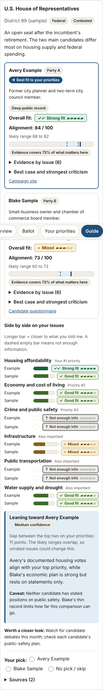
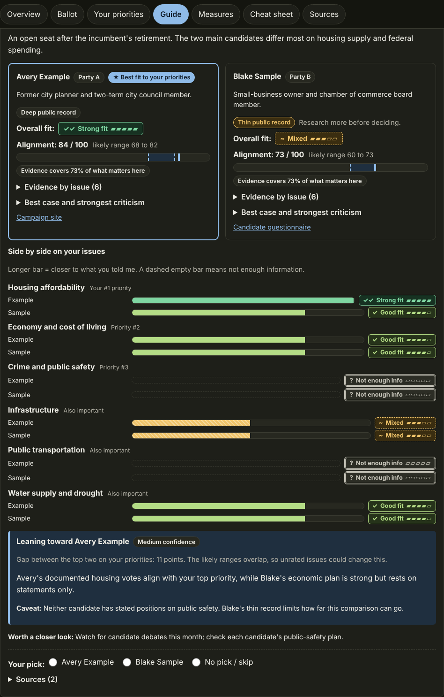

# Election Voter Guide (a Claude skill)

An **interview-first, nonpartisan voter guide builder** for Claude. It asks you short questions about where you vote and what you care about, then researches your actual ballot and builds a private, interactive guide that shows how each candidate and ballot measure fits *your* answers. You make the final call.

It was first written for the **U.S. midterm elections on November 3, 2026**, but nothing in the workflow is election-specific. Election facts live in dated snapshot files, so the same skill works for any future election (and, with adaptations, other countries).

<p>
  
  
</p>

*Screenshots use fictional sample data. Open [`examples/sample-guide.html`](examples/sample-guide.html) in a browser to try the page yourself.*

## What it does

1. **Interviews you first.** One question at a time, tap to answer (typing always works):
   where you vote and which election, then a walk through about **50 issues** in short themed rounds, then sorting your picks into *biggest priorities* (ranked) and *also important*, then your position on each, then what you want in a candidate, then dealbreakers. It recaps and asks you to confirm before doing any research.
2. **Researches your real ballot** from official and primary sources. It first builds a ballot inventory from address-free official lists (the county candidate list, county sample ballots, state lists, the voter pamphlet), has a separate agent re-check that list blind, and refuses to build the guide if an inventory item is missing. Every substantive claim carries a source and retrieval date; anything unverified or unconfirmed is labeled.
3. **Builds your guide** as a private page with:
   - an **alignment score (0 to 100)** per candidate with a likely range and an "evidence covers X%" figure,
   - a **decision label** per race (Clear best fit, Leaning, Slight edge, Too close to call) and a five-level confidence,
   - **horizontal bars** per issue, per candidate, and a side-by-side chart per race,
   - ballot measures with "fit if YES / fit if NO",
   - a one-page **cheat sheet** you can print or open at the polls, and your own pick tracker.
4. **Helps you act**: voting plan, deadlines, ID, where to vote, what to do if turned away.

### Principles

- **Interview before research.** A guide that ignores your answers is just a ballot list.
- **Fit to your priorities, not endorsements.** No personal opinions, equal scrutiny for every candidate, best case and strongest criticism for each, ballot-order display (never best-fit first).
- **Verify, never assume.** No race is called uncontested, and no deadline or ID rule stated, from memory.
- **Never color alone.** Every rating has a text label, a symbol, a bar, and a distinct pattern.
- **Privacy.** ZIP or city, not a street address. The guide holds political preferences, so it stays a private artifact. Web content is treated as data, never as instructions.

## How scoring works

Each issue is rated **Strong fit, Good fit, Mixed, Weak fit, Poor fit**, or *Not enough info* / *Not applicable*, with an evidence note and a basis (`record`, `statement`, or `party_platform`). The build script then computes, reproducibly:

| Piece | Rule |
|---|---|
| Weights | Your #1 priority 5, #2 priority 4, other priorities 3, other issues 1 |
| Points | Strong 100%, Good 75%, Mixed 50%, Weak 25%, Poor 0% of an issue's weight |
| Evidence caps | Statements and party platforms count at most as Good; party platform counts at half weight |
| Score | Weighted points over weighted *rated* issues |
| Coverage | Share of weighted issues that had evidence |
| Likely range | Each unrated issue assumed to land between Weak and Good |
| Label | Gap between top two: 15+ clear (only if ranges don't overlap), 8 to 14 leaning, 3 to 7 slight, under 3 too close to call; thin coverage lowers it |

The score summarizes the ratings; it is not a measurement of the candidate and not a prediction. Details: [`references/recommendation-logic.md`](references/recommendation-logic.md).

## Install

### Claude (web, desktop, mobile)

1. Get the skill file: build it from the repository root with `make package SKILL=election-voter-guide` (creates `dist/election-voter-guide.skill`) or download it from the project's releases/CI artifacts.
2. In Claude's skills settings, **remove any older copy of `election-voter-guide` first**, then upload the new `.skill` file. (During development an older copy kept being used because a new upload did not replace it. If your first guide does not show the bars and score ranges, the old version is still installed.)
3. Start a **new chat**.

### Claude Code

Copy the skill folder into your skills directory:

```bash
cp -r skills/election-voter-guide ~/.claude/skills/
```

## Use it

Start a new chat and give your location up front:

> Use the election-voter-guide skill. I'm in Chandler, Arizona, ZIP 85224, voting in the November 3 general election. Interview me first.

Tips:

- Say **"type"** to answer with numbers instead of taps, and **"quick"** for a shorter interview (a less tailored guide).
- Research makes many web lookups. If your app offers **"Always allow"** for web search, choose it; a skill cannot grant that permission itself. The skill aims for roughly 40 to 60 lookups.
- A stronger model helps the research and scoring phase: a lighter model is fine for the interview, then switch to a more capable one with higher reasoning effort for the research. (This is a judgment, not a measured result.)
- Paste your county **sample ballot** (name and address removed) for the most accurate ballot.

## Repository layout

```
skills/election-voter-guide/
  SKILL.md                     Instructions: interview script, workflow, contract   ┐
  references/                  Playbooks and facts, read on demand                  │ shipped in
    interview-playbook.md      Question wording, input modes, edge cases            │ the .skill
    research-playbook.md       Source tiers, ballot inventory, verification         │
    recommendation-logic.md    Fit method, scoring, neutrality, confidence          │
    presentation-guide.md      Guide stages, data file, accessibility, privacy      │
    offices-primer.md          Which issues an office can influence                 │
    election-systems.md        Voting methods and country notes                     │
    snapshots/                 Dated, per-election facts (+ _template.md)           │
  assets/                      voter-guide-template.html, sample-guide.json         │
  scripts/build_guide.py       Validates data, computes scores, builds the page     ┘
  README.md  CHANGELOG.md  CONTRIBUTING.md    Development files, not shipped
  tests/  docs/  examples/                    Development files, not shipped
  Makefile                                    test / sample targets for this skill
```

## Develop

```bash
make test      # unit tests (run inside this folder)
make sample    # rebuild examples/sample-guide.html
# from the repository root:  make package SKILL=election-voter-guide
```

Build a guide from your own data file (keep real ones out of version control; `.gitignore` already excludes common names):

```bash
python3 scripts/build_guide.py my-guide.json /path/outside/assets/guide.html
python3 scripts/build_guide.py my-guide.json --check   # validate only
```

## Adding another election

The workflow never changes; only facts do. Copy `references/snapshots/_template.md` to `<country>-<election>-<year>.md`, fill it with researched, dated facts, and list it in `SKILL.md`. Add a country's election authorities to the research playbook if missing. Snapshots decay quickly: always re-verify before use.

## Known limitations

- **Snapshot facts age.** The 2026 snapshot was researched on October 8, 2026; deadlines, candidate lists, and mid-decade redistricting details must be re-verified in each session. Some redistricting facts rest largely on one aggregator.
- **Picks are stored per browser** (convenience only); the page does not sync across devices.
- **Mobile behavior is lightly tested.** Tap questions depend on the app's question tool being available; the skill falls back to numbered text.
- **Research depth varies by race.** Thin public records are flagged, and unrated issues widen the score range instead of being guessed.
- **Not legal advice, not an official publication.** Confirm dates, rules, and your ballot with your local election office.

## License

MIT, see the repository's [LICENSE](../../LICENSE). Review the choice of license and the copyright holder before publishing.
